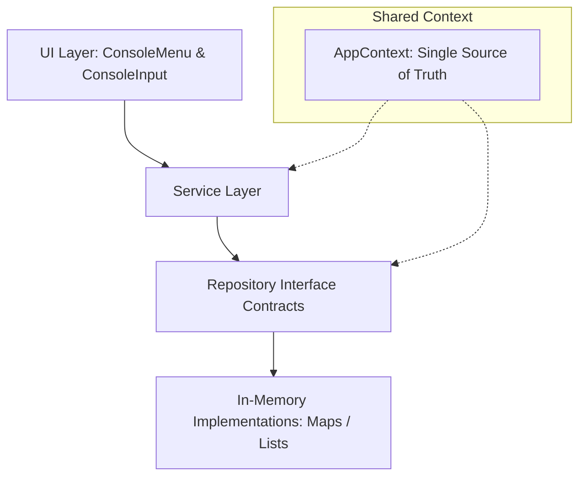

# StockWise — System Contracts & Architecture Blueprint

**Application:** StockWise — Student Inventory Demand Predictor  
**Tagline:** Smart Inventory. Smarter Decisions.  
**Version:** 1.0.0 (Evaluation 1 — Core Java In-Memory Edition)  
**Target Platform:** Java 17 LTS (Core Java, Zero External Dependencies)

---

## 1. Architectural Overview & Component Wiring

StockWise is designed using a **Layered Architecture with Inversion of Control (IoC)** to ensure separation of concerns and allow seamless migration to JDBC/MySQL in Evaluation 2.



### Module Ownership Among Four Team Members

| Member | Assigned Module | Core Responsibilities |
|---|---|---|
| **Harshita** | Demand Prediction & Forecasting | `Prediction.java`, `HistoricalDemand.java`, `PredictionStatus.java`, `PredictionService.java`, `PredictionRepository.java`, `HistoricalDemandRepository.java` |
| **Janvi** | Shared Data Architecture & Contracts | `AppContext.java`, Repository Interfaces, In-Memory Storage Coordination, `IDGenerator.java`, Data Consistency |
| **Anmol** | Inventory Management & Stock Alerts | `Inventory.java`, `StockStatus.java`, `StockHistory.java`, `TransactionType.java`, `InventoryService.java`, `StockAlertService.java` |
| **Sidak** | Student & Demand Management | `Student.java`, `DemandRecord.java`, `DemandStatus.java`, `StudentService.java`, `DemandService.java` |

---

## 2. Model Contracts (`com.stockwise.model`)

### 2.1 `Inventory` (Author: Anmol)
Represents a physical SKU held in the college inventory.
- **Package:** `com.stockwise.model`
- **Fields:**
  - `private String itemId` (Business primary key, e.g., `"ITM-1001"`)
  - `private String itemName` (Mandatory, non-empty)
  - `private String category` (Default: `"General"`)
  - `private String description` (Optional details)
  - `private int availableQuantity` (>= 0, non-negative)
  - `private double price` (>= 0.0, non-negative)
  - `private int minimumStock` (>= 0, safety stock threshold)
  - `private LocalDate dateAdded` (Creation date)
- **Constructors:**
  - `public Inventory(String itemId, String itemName, String category, String description, int availableQuantity, double price, int minimumStock, LocalDate dateAdded)`
- **Key Methods:**
  - `public StockStatus getStockStatus()`: Returns `IN_STOCK` if `qty > min`, `LOW_STOCK` if `0 < qty <= min`, `OUT_OF_STOCK` if `qty == 0`.
  - Getters and setters with validation.

### 2.2 `Student` (Author: Sidak)
Represents a registered college student eligible to request inventory items.
- **Fields:**
  - `private String studentId` (Unique ID, e.g., `"STU-1001"`)
  - `private String studentName` (Non-empty)
  - `private String rollNumber` (Unique student roll number, non-empty)
  - `private String department` (e.g., Computer Science, IT)
  - `private String email` (Valid email pattern: `user@domain.com`)
  - `private String phoneNumber` (7-20 digit phone format)
- **Constructors:**
  - `public Student(String studentId, String studentName, String rollNumber, String department, String email, String phoneNumber)`

### 2.3 `DemandRecord` (Author: Sidak)
Represents a student's demand/request for an inventory item.
- **Fields:**
  - `private String demandId` (Unique ID, e.g., `"DMD-1001"`)
  - `private String studentId` (Foreign key to `Student`)
  - `private String itemId` (Foreign key to `Inventory`)
  - `private int requestedQuantity` (> 0, strictly positive)
  - `private LocalDate requestDate` (Date logged)
  - `private DemandStatus status` (`PENDING`, `ISSUED`, `REJECTED`)
  - `private String remarks` (Administrative remarks or rejection justification)
- **Constructors:**
  - `public DemandRecord(String demandId, String studentId, String itemId, int requestedQuantity, LocalDate requestDate, DemandStatus status, String remarks)`
  - `public DemandRecord(String demandId, String studentId, String itemId, int requestedQuantity)`

### 2.4 `StockHistory` (Author: Anmol / Janvi)
Audit log tracking every inventory stock increment, deduction, or adjustment.
- **Fields:**
  - `private String historyId` (Unique ID, e.g., `"TXN-1001"`)
  - `private String itemId` (Associated item)
  - `private TransactionType transactionType` (`STOCK_ADDED`, `STOCK_ISSUED`, `STOCK_ADJUSTED`, `HISTORICAL_ENTRY`)
  - `private int quantityChanged` (+delta for additions, -delta for issuances, 0 for historical records)
  - `private LocalDate transactionDate`
  - `private String remarks`

### 2.5 `HistoricalDemand` (Author: Harshita)
Represents verified historical monthly consumption used strictly for demand forecasting.
- **Fields:**
  - `private String id` (Unique ID, e.g., `"HD-1001"`)
  - `private String itemId` (Target item)
  - `private YearMonth yearMonth` (Historical calendar period, e.g., `2026-08`)
  - `private int consumedQuantity` (>= 0)
  - `private String remarks`
- **Important Invariant:** Recording historical demand **never** alters active inventory stock or creates student demand records.

### 2.6 `Prediction` (Author: Harshita)
Encapsulates 3-month moving average prediction results.
- **Fields:**
  - `private String predictionId` (Unique ID, e.g., `"PRD-1001"`)
  - `private String itemId`
  - `private YearMonth targetYearMonth`
  - `private double predictedDemand`
  - `private Integer actualDemand` (Nullable, recorded post-month)
  - `private int suggestedRestockQuantity`
  - `private LocalDate predictionDate`
  - `private PredictionStatus status` (`SUFFICIENT`, `INSUFFICIENT_HISTORY`)
  - `private boolean highDemand` (True if `predictedDemand > currentStock`)
  - `private List<MonthConsumption> referenceMonths` (Detailed breakdown of 3 evaluation months)
  - `private String explanation`

---

## 3. Repository Interfaces (`com.stockwise.repository`)

Prepared for Evaluation 2 JDBC swap.

### 3.1 `InventoryRepository`
```java
public interface InventoryRepository {
    Inventory save(Inventory item);
    Optional<Inventory> findById(String itemId);
    List<Inventory> findAll();
    List<Inventory> findByNameContaining(String name);
    List<Inventory> findByCategory(String category);
    boolean deleteById(String itemId);
    boolean existsById(String itemId);
    int count();
}
```

### 3.2 `StudentRepository`
```java
public interface StudentRepository {
    Student save(Student student);
    Optional<Student> findById(String studentId);
    Optional<Student> findByRollNumber(String rollNumber);
    List<Student> findAll();
    List<Student> findByNameContaining(String name);
    boolean deleteById(String studentId);
    boolean existsById(String studentId);
    boolean existsByRollNumber(String rollNumber);
    int count();
}
```

### 3.3 `DemandRepository`
```java
public interface DemandRepository {
    DemandRecord save(DemandRecord demand);
    Optional<DemandRecord> findById(String demandId);
    List<DemandRecord> findAll();
    List<DemandRecord> findByStatus(DemandStatus status);
    List<DemandRecord> findByItemId(String itemId);
    List<DemandRecord> findByStudentId(String studentId);
    List<DemandRecord> findByItemIdAndStatus(String itemId, DemandStatus status);
    boolean deleteById(String demandId);
    int count();
    int countByStatus(DemandStatus status);
}
```

### 3.4 `StockHistoryRepository`
```java
public interface StockHistoryRepository {
    StockHistory save(StockHistory history);
    List<StockHistory> findAll();
    List<StockHistory> findByItemId(String itemId);
    List<StockHistory> findRecent(int limit);
    int count();
}
```

### 3.5 `HistoricalDemandRepository`
```java
public interface HistoricalDemandRepository {
    HistoricalDemand save(HistoricalDemand demand);
    Optional<HistoricalDemand> findByItemIdAndYearMonth(String itemId, YearMonth yearMonth);
    List<HistoricalDemand> findByItemId(String itemId);
    List<HistoricalDemand> findAll();
    boolean existsByItemIdAndYearMonth(String itemId, YearMonth yearMonth);
    int count();
}
```

### 3.6 `PredictionRepository`
```java
public interface PredictionRepository {
    Prediction save(Prediction prediction);
    Optional<Prediction> findById(String predictionId);
    List<Prediction> findAll();
    List<Prediction> findByItemId(String itemId);
    Optional<Prediction> findLatestByItemId(String itemId);
    int count();
}
```

---

## 4. Service Contracts (`com.stockwise.service`)

### 4.1 `InventoryService` (Author: Anmol)
- `Inventory addItem(String itemId, String itemName, String category, String description, int quantity, double price, int minStock)`
  - *Validation:* Unique `itemId`, non-negative `quantity`, `price`, and `minStock`. Auto-generates ID if empty. Logs `STOCK_ADDED` if initial `quantity > 0`.
- `List<Inventory> getAllItems()`
- `Inventory getItemById(String itemId)` (Throws `ResourceNotFoundException` if missing)
- `List<Inventory> searchByName(String name)`
- `Inventory updateItem(String itemId, String newName, String newCategory, String newDesc, Double newPrice, Integer newMinStock)`
- `boolean deleteItem(String itemId)`
  - *Business Rule:* Rejects deletion with `ValidationException` if dependent demand records exist.
- `Inventory addStock(String itemId, int quantityToAdd, String remarks)`
  - *Business Rule:* Strictly positive quantity. Increases stock, records `STOCK_ADDED` history.
- `Inventory adjustStock(String itemId, int newQuantity, String reason)`
  - *Business Rule:* Non-negative quantity. Sets new stock, records `STOCK_ADJUSTED` with delta and justification.

### 4.2 `StudentService` (Author: Sidak)
- `Student addStudent(String studentId, String studentName, String rollNumber, String department, String email, String phone)`
  - *Validation:* Unique `studentId`, unique `rollNumber`, valid email, valid phone.
- `List<Student> getAllStudents()`
- `Student getStudentById(String studentId)`
- `Student getStudentByRollNumber(String rollNumber)`
- `List<Student> searchByName(String name)`
- `Student updateStudent(String studentId, String name, String dept, String email, String phone)`
- `boolean deleteStudent(String studentId)`
  - *Business Rule:* Rejects deletion if dependent demand records exist.

### 4.3 `DemandService` (Author: Sidak)
- `DemandRecord submitDemand(String studentId, String itemId, int requestedQuantity, String remarks)`
  - *Validation:* Verifies `studentId` and `itemId` exist. Strictly positive `requestedQuantity`. Sets status to `PENDING`. Does **not** modify inventory stock.
- `DemandRecord issueDemand(String demandId, String adminRemarks)`
  - *Critical Atomic Rule:*
    1. Demand exists and status is `PENDING`.
    2. Available stock >= `requestedQuantity`.
    3. Deducts stock exactly once.
    4. Updates status to `ISSUED`.
    5. Records `STOCK_ISSUED` in stock history.
    6. Throws `InsufficientStockException` if stock insufficient.
- `DemandRecord rejectDemand(String demandId, String rejectionReason)`
  - *Rule:* Verifies demand is `PENDING`. Sets status to `REJECTED`. Does **not** modify inventory stock.

### 4.4 `PredictionService` (Author: Harshita)
- `HistoricalDemand recordHistoricalDemand(String itemId, int year, int month, int consumedQuantity, String remarks)`
  - *Validation:* Item exists, month (1-12), quantity (>= 0). Rejects duplicate (itemId, yearMonth). Does not alter inventory stock.
- `Prediction predictDemandForItem(String itemId, YearMonth targetMonth)`
  - *Coverage Rule:*
    - Evaluates the three previous completed calendar months: `T-3`, `T-2`, `T-1`.
    - For each month, consumption = sum of `ISSUED` demands + `HistoricalDemand` (if any).
    - If any of the 3 months has neither an explicit historical record (even with 0) nor an issued demand, month has **no coverage**.
    - If any required month lacks coverage, prediction is marked `INSUFFICIENT_HISTORY` (predicted demand = 0.0). Missing months are **never** silently assumed to be zero.
    - If all 3 months have coverage:
      $$\text{Predicted Demand} = \frac{Q_1 + Q_2 + Q_3}{3}$$
      $$\text{Suggested Restock} = \max\left(0, \lceil \text{Predicted Demand} + \text{Minimum Stock} - \text{Available Stock} \rceil\right)$$
      $$\text{High Demand} = \text{Predicted Demand} > \text{Available Stock}$$
- `List<Prediction> predictForAllItems(YearMonth targetMonth)`

### 4.5 `StockAlertService` (Author: Anmol)
- `List<StockAlertItem> generateAllAlerts()`
  - Computes active low-stock, out-of-stock, and high-demand alerts with restock recommendations.
- `List<StockAlertItem> getLowStockAlerts()`
- `List<StockAlertItem> getOutOfStockAlerts()`
- `List<StockAlertItem> getHighDemandAlerts()`

### 4.6 `ReportService` (All Members / Dashboard)
- `DashboardMetrics getDashboardMetrics()`: Computes real live metrics across all repositories (no hardcoded metrics).
- `List<MonthlyDemandAggregate> getMonthlyDemandSummary()`: Chronological demand consumption by month.

---

## 5. Shared Context Contract (`com.stockwise.storage.AppContext`)

```java
public class AppContext {
    // Singletons
    public InventoryRepository getInventoryRepository();
    public StudentRepository getStudentRepository();
    public DemandRepository getDemandRepository();
    public StockHistoryRepository getStockHistoryRepository();
    public HistoricalDemandRepository getHistoricalDemandRepository();
    public PredictionRepository getPredictionRepository();

    public InventoryService getInventoryService();
    public StudentService getStudentService();
    public DemandService getDemandService();
    public PredictionService getPredictionService();
    public StockAlertService getStockAlertService();
    public ReportService getReportService();

    public void seedInitialData();
}
```

---

## 6. Migration Blueprint for Evaluation 2 (JDBC / MySQL)

In Evaluation 2, **zero business service code will need to be rewritten**.
Only the repository interface implementations will be swapped:

1. Create `com.stockwise.repository.jdbc.JdbcInventoryRepository implements InventoryRepository`.
2. Connect to MySQL via `java.sql.Connection` and use `PreparedStatement` to run SQL queries.
3. In `AppContext.java`, swap:
   ```java
   // Evaluation 1:
   // this.inventoryRepository = new InMemoryInventoryRepository();
   
   // Evaluation 2:
   this.inventoryRepository = new JdbcInventoryRepository(connectionPool);
   ```
4. All services, models, menus, predictions, and validation remain untouched!
